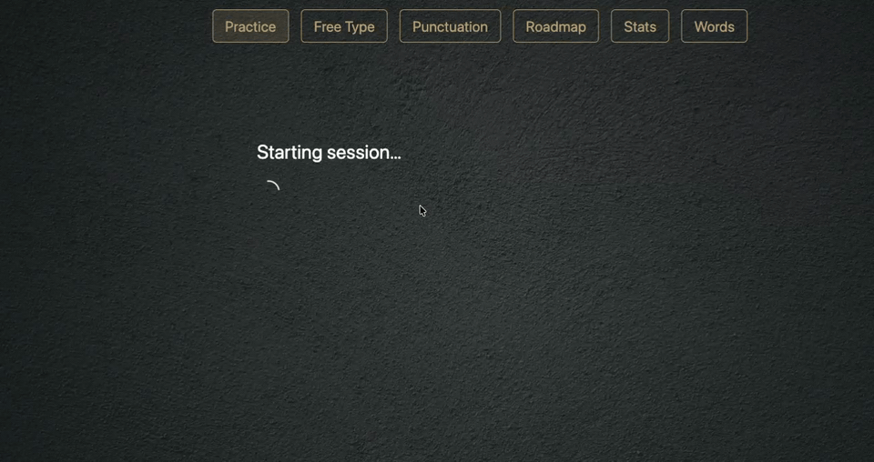
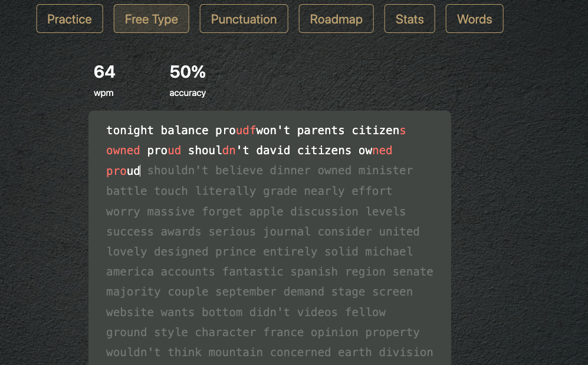
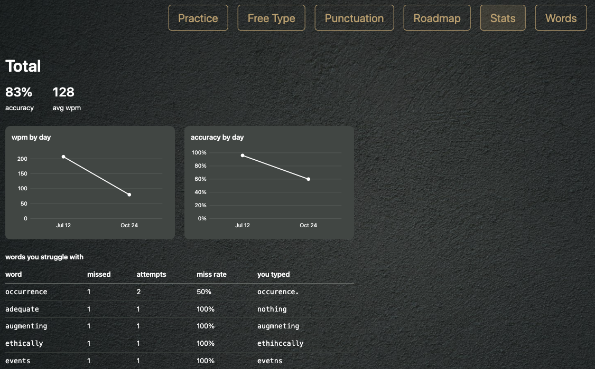

# Typing Practice



<p>
  
  
</p>

It keeps a list of words you misspell, has an LLM write practice sentences around them, and grades what you type. Words you keep missing stay in rotation, and words you get right ten times in a row graduate out.

## How it works

**Practice**: Your seven weakest words, plus a graduated word when it's due for a re-test (after 1, 3, 7, then 21 days), rotate into 9 sentences. A session takes 10-30 seconds.

**Free Type**: A board of common English words, minus the ones you're already drilling. Space ends a word. Miss the same word three times and it joins your weak list.

**Punctuation**: Nine sentences per session, each drilling one of 11 punctuation features (commas, semicolons, colons, apostrophes, quotes, and so on). The marks you miss most come first. Case counts, spelling doesn't.

## Running it

```
make install
```

Then start both servers from one terminal (Ctrl-C stops both):

```
make dev
```

Open http://localhost:3005. Or run them separately, each in its own terminal:

```
make backend
make frontend
```

Runs on a local Ollama model by default, so no API key is needed (see Setup).

To run on a single port with no Vite dev server, build the frontend and let the backend serve it:

```
make serve
```

Open http://localhost:8016. The backend serves `frontend/dist` if it exists, and forwards `/api/...` to its routes the way the dev proxy does.

The backend port is set in the `Makefile`, the frontend port in `frontend/vite.config.ts`.

This is still a local setup with no login, so don't expose the port to a network.

## Profiles

| | Personal | Testing |
|---|---|---|
| database | `typing.db` | `typing_test.db` |
| transcripts | `sessions/` | `sessions_test/` |
| sentences | LLM-generated from your weak words | canned set from `test_agent.py` |

Separate files, not a flag. Test data cannot reach your real numbers. The backend binds each request to a profile via an `X-Profile` header; nothing is remembered client-side.

The testing profile lets you click through the UI without paying for model calls or waiting 10+ seconds per session.

## Setup

By default the app runs free and local: have [Ollama](https://ollama.com) running with a text model pulled (`OLLAMA_MODEL`, defaults to `qwen3.5:4b`). No key and no internet needed, but only as good as the model you've got pulled.

To use a paid model instead, edit `.env` at the repo root:

```
ANTHROPIC_API_KEY=your-key-here
OPENAI_API_KEY=your-key-here
LLM_PROVIDER=anthropic  # or openai, local is the default
```

Only set the key for the provider you're using. If it's missing, the server prints which variable it needs rather than crashing.

## Known rough edges

- Punctuation sessions cannot detect a dropped trailing period; you must type something to submit a sentence, but that space doesn't count as the missing mark.
- Free Type clock never pauses when switching tabs; cosmetic display only, never stored.
